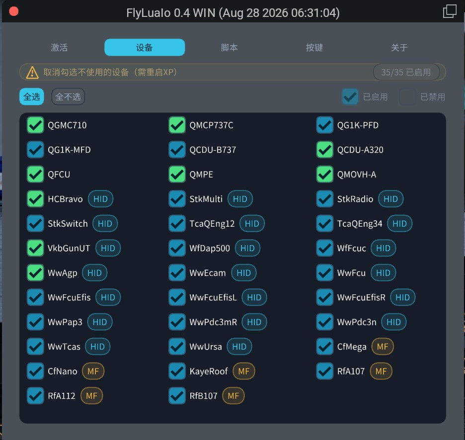

# flyluaiosc

Use Lua to control flight simulation USB HID / MobiFlight hardware I/O.

**FlyLuaIoSc** is the MSFS edition of FlyLuaIo — *Sc* for SimConnect. A standalone Windows application that
drives USB HID cockpit panels and MobiFlight serial boards inside **Microsoft Flight Simulator
2020 / 2024**. Aircraft mappings are plain Lua scripts: add a panel, edit a script, no compiler.

> **X-Plane 11 / 12 users:** FlyLuaIoSc does not talk to X-Plane. Use
> [FlyLuaIo](https://gitee.com/FlyLuaIo/flyluaio/releases) — same hardware, native on Windows,
> macOS (Apple Silicon and Intel) and Linux.

# Download

**https://gitee.com/FlyLuaIo/flyluaiosc/releases** — take the latest
`flyluaiosc_<version>_msfs_installer.zip`, unzip it and run the installer inside.

# Install

1. **Exit MSFS first.** The installer stops with *"MSFS is Running, Exit MSFS at first."* while the sim is up.
2. Run the installer. It detects your MSFS Community folders (2020 and 2024, Store and Steam) and lists
   them on the *Community Folder* page — confirm them, the MobiFlight event module is copied there.
3. Choose components. Only the core is mandatory. The optional ones are helpers: **FlyLuaIoSc Auto Start**
   (start with Windows login), **crash dump** (a crash then leaves something you can send),
   **Start Menu Shortcut**, **Reset configuration**, **QCDU MCDU Asobo** (Asobo CJ4 MCDU → QCDU screen).
4. Finish. The wizard runs a fix-up pass: FlyLuaIoSc is registered in the `exe.xml` of every MSFS it found
   so the sim starts it, and the MobiFlight event module is copied into each Community folder. It then
   starts FlyLuaIoSc once to activate it — after that the app lives in the system tray.

Installed per-user into `%LOCALAPPDATA%\cpuwolf\flyluaiosc` — no admin rights, nothing in Program Files.
Requirements: Windows (64-bit), MSFS 2020 or 2024, internet access for the one-time activation.

Full walkthrough — installer pages, every component, file locations, updating, uninstall and
troubleshooting: **[doc/install.md](doc/install.md)**

# Features

* **Any USB HID panel** — a JSON file describes the device. No compile step, no vendor SDK.
* **Any MobiFlight board** — buttons, encoders, steppers, servos, shift registers, segment and LCD displays,
  matched by board serial.
* **Real-Time Add Device** — Json + Lua *is* a new USB HID / MobiFlight device, without compiling code.
* **Built-in Lua Language Engine** — simple to use and easy to customize.
* **Easy Debugging** — automatically reload Lua scripts after editing the Lua file, speeding up the debugging process.
* **Automatic Flight Device Key Assignment** — say goodbye to the pain of manually setting hundreds of keys.
* **Smooth Aircraft Switching** — one profile per aircraft, no searching the internet for configuration files.
* **Cold and dark, and failures** — hardware loads the aircraft's real state instead of a guessed default.
* **Update without reinstalling** — *Update Scripts Patch* pulls new aircraft profiles and device definitions.
* **One-click log upload** — no zip juggling when you need support.
* **Home Assistant** — sim events into HA, automations out: [flyluaioha](https://github.com/FlyLuaIo/flyluaioha).

# Game/Hardware Compatibility List

Every device below is detected out of the box; the second column is the name you will see in the
*Devices* tab, so you can match it against your own list.

| Hardware | Detected as | Connection |
|---|---|---|
| **QuickMade** | | |
| QGMC710 | `QGMC710` | USB HID |
| QG1K PFD / MFD (G1000) | `QG1K-PFD`, `QG1K-MFD` | USB HID |
| QMCP737C | `QMCP737C` | USB HID |
| QCDU-A320, QCDU-B737 | `QCDU-A320`, `QCDU-B737` | USB HID |
| QFCU | `QFCU` | USB HID |
| QMPE | `QMPE` | USB HID |
| QMOVH-A | `QMOVH-A` | USB HID |
| **WinWing / WinCtrl** | | |
| AGP | `WwAgp` | USB HID |
| PAP3 | `WwPap3` | USB HID |
| PDC-3M-R | `WwPdc3mR` | USB HID |
| PDC-3N | `WwPdc3n` | USB HID |
| FCU | `WwFcu` | USB HID |
| FCU + EFIS (combined, left, right) | `WwFcuEfis`, `WwFcuEfisL`, `WwFcuEfisR` | USB HID |
| ECAM | `WwEcam` | USB HID |
| TCAS | `WwTcas` | USB HID |
| URSA Throttle | `WwUrsa` | USB HID |
| **Thrustmaster** | | |
| TCA Q-Eng 1&2 | `TcaQEng12` | USB HID |
| TCA Q-Eng 3&4 | `TcaQEng34` | USB HID |
| **Honeycomb** | | |
| Bravo | `HCBravo` | USB HID |
| **Saitek / Logitech** | | |
| Multi Panel, Radio Panel, Switch Panel | `StkMulti`, `StkRadio`, `StkSwitch` | USB HID |
| **VKBsim** | | |
| Gunfighter MCG Ultimate Twist | `VkbGunUT` | USB HID |
| **WingFlex** | | |
| DAP 500, FCU Cube | `WfDap500`, `WfFcuc` | USB HID |
| **MobiFlight boards** | | |
| Rowsfire A107 V3 / A112 / B107 V1 | `RfA107`, `RfA112`, `RfB107` | Serial |
| MobiFlight Mega Pro, CPUWOLF MF NANO | `CfMega`, `CfNano` | Serial |
| Kaye Roof | `KayeRoof` | Serial |
| miniCOCKPIT miniFCU / miniEFIS | `MiniFCU` | Serial (MobiFlight firmware) |

*Adding ...* — Json + Lua is a new USB HID / MobiFlight device, see
**[doc/custom-device.md](doc/custom-device.md)**.

The QCDU buttons are driven by FlyLuaIoSc, its **screen** is not — use
[MCDUHub](https://x-plane.vip/quickmade/support/) for the display.

Per-aircraft coverage is a much bigger matrix; check it per device here:
[Device Game Compatibility List](https://docs.qq.com/sheet/DWERFQnRmVUFZeHBi?tab=000001)

# Settings

FlyLuaIoSc has no main window — it runs in the system tray. Right-click the tray icon and choose
*Settings* to open the window: **Activation / Devices / Scripting / Keys / About**.

If you don't want FlyLuaIoSc to control a panel (for example because the brand's own software should keep
it, like WinWing SimApp Pro), open **Devices** and untick it. The change applies after a sim restart.

Other tabs: **Scripting** opens the script folder and has *Reload Scripts*, *Update Scripts Patch* and
*Upload Log*; **Keys** finds and resets one panel's key assignment.

# Documentation

| Document | Content |
|---|---|
| [doc/install.md](doc/install.md) | installer walkthrough, components, activation, file locations, updating, uninstall, troubleshooting |
| [doc/custom-device.md](doc/custom-device.md) | add your own USB HID or MobiFlight device with JSON + Lua |
| [doc/support.md](doc/support.md) | logs, script patches, where to ask, privacy |

# Support

* Discord — [discord.gg/XEamJAejWS](https://discord.gg/XEamJAejWS)
* QQ 群 — 378072629
* Email — QuickMade@qq.com (orders, licensing, confidential matters)
* Video — [youtube.com/@cpuwolf](https://www.youtube.com/@cpuwolf) · [Bilibili](https://space.bilibili.com/323386663/)

Before writing, send the log — *Scripting* tab (or tray menu) → **Upload Log**. It takes 30 seconds and
usually answers the question on the spot. Details: [doc/support.md](doc/support.md).

# Release notes

Every release lists core and script changes on the Gitee release page:
https://gitee.com/FlyLuaIo/flyluaiosc/releases
