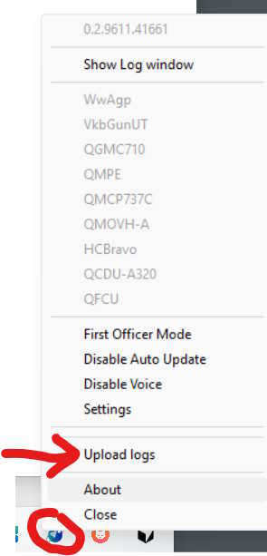
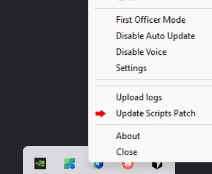

# Support

## Send the log first

Nine out of ten questions are answered by the log, and one button sends it. In the tray menu pick
**Upload logs**, or *Settings → Scripting → **Upload Log***:

What happens: FlyLuaIoSc packages its log and uploads it. Nothing else is in the bundle — not your Lua
scripts, not your device definitions, not `%APPDATA%\flyluaio.cfg`. If you would rather not upload
anything, the log sits at `%LOCALAPPDATA%\cpuwolf\flyluaiosc\flyluaio.log` (`qmdev.1.log` is the previous
rotation); attach it to an email instead.

Mention the version if you can — it is in the tray menu and on the **About** tab, and in the first line of
the log.

## Picking up new aircraft without reinstalling

*Settings → Scripting* → **Update Scripts Patch** (same item in the tray menu):

It compares the aircraft profiles and device definitions you have against the server's list and downloads
only what changed. Use it when a new aircraft or panel was announced, or when a profile you have is
behaving badly — the fix usually ships as a script patch long before a new installer does.

If the patch fails, install the current release from
[the releases page](https://gitee.com/FlyLuaIo/flyluaiosc/releases) instead; the installer carries the same
scripts.

## Where to ask

| Channel | When |
|---|---|
| [Discord](https://discord.gg/XEamJAejWS) | Fastest. Screenshots and logs welcome, other users help too. |
| QQ 群 378072629 | Chinese-language channel. |
| [cpuwolf@gmail.com](mailto:cpuwolf@gmail.com) | Orders, licensing, anything confidential. |
| [youtube.com/@cpuwolf](https://www.youtube.com/@cpuwolf) · [Bilibili](https://space.bilibili.com/323386663/) | Installation and feature videos. |

A report that gets fixed fast contains: which panel, which aircraft and sim version, what you pressed, what
happened instead — plus the log. "It doesn't work" costs a round trip every time.

## Compatibility lists

* Hardware and aircraft matrix, one sheet per device:
  [docs.qq.com · Game Compatibility List](https://docs.qq.com/sheet/DWERFQnRmVUFZeHBi?tab=000001)
* Supported hardware at a glance: [README](../README.md#gamehardware-compatibility-list)

## What leaves your machine

Being explicit about this, because "it just works" software usually isn't:

| Event | What is sent | Can you turn it off |
|---|---|---|
| Activation | device UUID, computer name, list of connected USB devices — for license verification only | no, it is the license |
| Update check | version + platform | yes — *Disable Auto Update* in the tray menu |
| Log upload | the log files described above | it only runs when you click it |
| Scripts patch | version + checksums of the script files you have | it only runs when you click it |

No account, no cloud dependency: scripts run locally, and the simulator data never leaves the machine.
The upstream script repository — every definition and aircraft profile that ships with FlyLuaIoSc — is
public at [github.com/FlyLuaIo/flyluaioscripts](https://github.com/FlyLuaIo/flyluaioscripts), so you can
read exactly what will run.

## See also

[install.md](install.md) — installation, components, paths, uninstall, troubleshooting table.
[custom-device.md](custom-device.md) — adding hardware with JSON + Lua.
